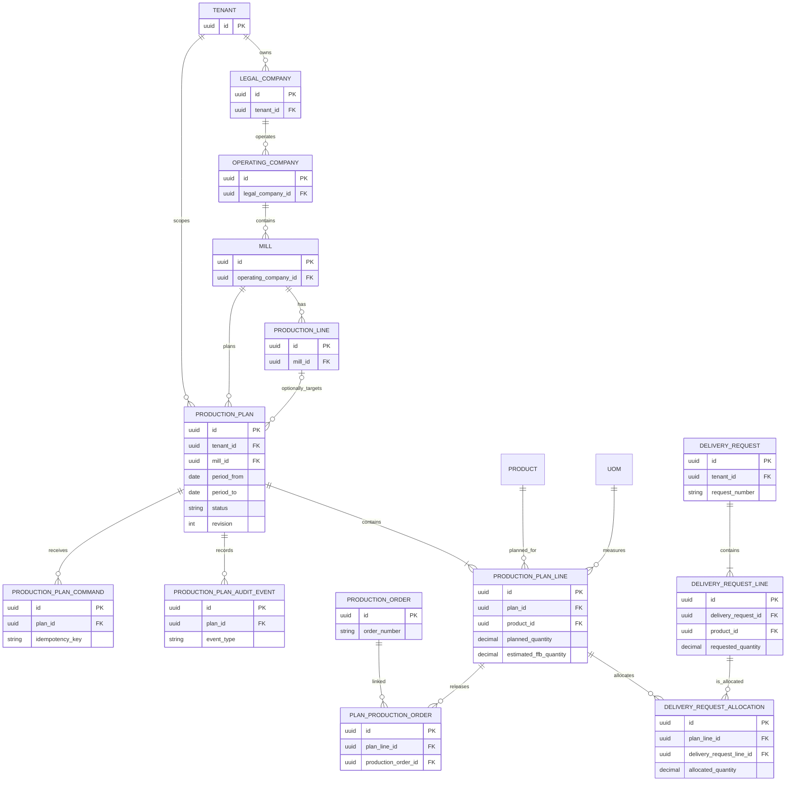

# Production Planning Module — Screen-wise Functional Requirements

**Product:** ROCKEYE ERP + MES  
**Module:** Production Planning  
**Domain:** Manufacturing  
**Document status:** Functional baseline  
**Version:** 1.0  
**Date:** 28 October 2026

## 1. Purpose

Production Planning converts eligible customer delivery demand into a time-phased, material-aware production plan for a mill. The planner selects a planning month and, optionally, a week; selects the Delivery Requests to fulfil; reviews stock and requirements; calculates estimated FFB input; and saves a traceable draft plan for review, approval, and downstream Production Order creation.

Production Planning is a planning and decision-support module. It does not replace Delivery Requests, Inventory Ledger, Production Orders, Shift Production Records, or posted inventory transactions.

## 2. Business outcome

The module must answer these questions for every planning window:

1. Which approved Delivery Requests are being planned?
2. Which product quantities are required by month and week?
3. What stock is available before production?
4. What is the net production requirement after available and reserved stock?
5. What estimated FFB/input quantity is required based on configured yield?
6. Which requests and quantities are already allocated to another plan?
7. What plan is awaiting review, approval, release, or execution?

## 3. Scope and boundaries

### In scope

- Month and week planning-period selection.
- Eligible Delivery Request discovery and selection.
- Demand allocation to a Production Plan.
- Product/material requirement calculation.
- Available stock and reservation visibility.
- Estimated FFB/input calculation.
- Plan draft creation, review, approval, release, cancellation, and closure.
- Plan-to-Production-Order linkage.
- Plan-versus-actual reporting.
- Tenant, legal company, mill, and optional production-line scope.
- Audit trail, permissions, revisions, and conflict handling.

### Out of scope

- Creating or changing customer Delivery Requests.
- Posting inventory movements directly from the planning screen.
- Executing production stages.
- Recording shift production results.
- Replacing the Inventory Ledger as the stock authority.
- Replacing Sales Contract fulfillment logic.
- Certified sustainability mass-balance posting.

## 4. Organization and data scope

Every Production Plan is scoped to:

`Tenant → Legal Company / Operating Company → Mill / Site → optional Production Line`

The server must enforce scope on all reads, calculations, allocations, lifecycle commands, reports, and integrations. A user must never see or allocate a Delivery Request, stock balance, Production Order, or plan from another tenant or mill.

## 5. User roles and permissions

| Role / permission | Capability |
|---|---|
| `production.plan.read` | View plan screens, demand, stock position, and reports. |
| `production.plan.create` | Create and save a draft Production Plan. |
| `production.plan.update` | Edit a Draft or Proposed plan. |
| `production.plan.submit` | Submit a Draft plan for review. |
| `production.plan.approve` | Approve or reject a plan. |
| `production.plan.release` | Release approved quantities for Production Order creation/linkage. |
| `production.plan.cancel` | Cancel a plan according to lifecycle rules. |
| `production.plan.report` | View and export plan-versus-actual and planning reports. |

Frontend visibility is not a security boundary. The API must authorize every command.

## 6. Navigation

Under **Production**:

- Production Runs
- Production Planning
- Demand View
- Plan vs Actual
- Production Orders
- Routing
- Production Line

The user-facing module name is **Production Planning**. “Planning Workspace” is an internal screen concept and must not be shown as a competing module name.

---

# 7. Screen 1 — Production Planning Workspace

## 7.1 Purpose

The primary planner workspace. It provides the planning-period controls, selected-demand position, stock position, calculated requirements, calendar buckets, and links to related Production Orders.

## 7.2 Header

| Element | Requirement |
|---|---|
| Breadcrumb | `Production > Production Planning` |
| Page title | `Production Planning` |
| Description | Explain that the screen plans production against demand, stock, and projected closing position. |
| Create action | `New Production Plan` opens the plan creation workflow. |
| Mill context | Show the active mill/site context. If multi-mill selection is supported, changing it reloads all data. |
| Period summary | Show selected month, selected week or Whole Month, and the inclusive date range. |

## 7.3 Planning-period controls

| Field | Type | Required | Rules |
|---|---|---:|---|
| Planning Month | Month picker | Yes | Selects a calendar month in the mill operating calendar. |
| Planning Week | Select | Yes | `Whole Month`, `Week 1`, `Week 2`, `Week 3`, `Week 4`, `Week 5`. Week dates are derived from the selected month. |
| Product | Select | No | Filters the workspace by active Item/Product. |
| View grain | Toggle | Yes | `Month`, `Week`, or `Day` for visual analysis. It does not silently change the saved plan period. |

Week definition must be explicit and configurable. The initial Phase 1 convention is:

- Week 1: days 1–7
- Week 2: days 8–14
- Week 3: days 15–21
- Week 4: days 22–28
- Week 5: days 29–end of month

The selected month and week must be sent to the server as exact `periodFrom` and `periodTo` dates.

## 7.4 KPI cards

The workspace displays:

- Total selected demand.
- Available stock.
- Reserved stock.
- Net requirement.
- Planned production.
- Estimated FFB required.
- Actual production.
- Projected closing stock.

All quantities must show their UOM. KPI values must be calculated from the current scope and selected period, not hard-coded demo values.

## 7.5 Product planning position table

| Column | Description |
|---|---|
| Product / Material | Active Item/Product reference. |
| Selected Demand | Quantity from selected Delivery Request lines. |
| Opening Stock | Posted stock at the start of the period. |
| Available Stock | Stock available after existing reservations. |
| Reserved Stock | Stock reserved for dispatch/loading or other approved commitments. |
| Safety Stock | Configured policy quantity. |
| Net Requirement | Calculated production requirement. |
| Planned Quantity | Quantity assigned to the plan. |
| Estimated FFB Required | Required input quantity based on yield/conversion. |
| Produced | Posted actual production in the period. |
| Remaining | Planned quantity not yet produced. |
| Projected Closing | Projected stock at period end. |
| Status / Risk | Derived risk such as Healthy, Below Safety Stock, Shortfall Risk, or Excess Stock. |

## 7.6 Calendar planning view

The calendar view displays month, week, or day buckets with:

- Bucket start and end dates.
- Selected demand quantity.
- Planned quantity.
- Actual quantity.
- Remaining quantity.
- Linked Production Order count.
- Risk or shortage indicator.

Buckets must be non-overlapping, inclusive, and generated using the mill time zone/calendar configuration.

## 7.7 Storage position section

Show stock by storage location, tank, silo, warehouse, or yard where available:

- Product/material.
- Storage location.
- Opening quantity.
- Current balance.
- Reserved quantity.
- Available quantity.
- UOM.
- Last updated timestamp.

The screen is read-only for inventory. It must never update balances directly.

## 7.8 Related Production Orders

Show linked orders with:

- Production Order number.
- Product/material.
- Mill and production line.
- Planned dates.
- Planned input quantity.
- Status.
- Planned, produced, and remaining quantities.

The user can open the Production Order but cannot change a released plan’s quantities from this section.

---

# 8. Screen 2 — Create Production Plan

## 8.1 Purpose

Create a Draft Production Plan by selecting a planning period, mapping Delivery Requests, and reviewing calculated material requirements before saving.

## 8.2 Step 1 — Planning period

| Field | Type | Required | Rules |
|---|---|---:|---|
| Plan Name | Text | No | Defaults to `Production Plan {Month} {Week}`. |
| Planning Month | Month picker | Yes | Determines the planning month. |
| Planning Week | Select | Yes | Whole Month or a configured week. |
| Expected Yield % | Decimal | Yes | Must be greater than 0 and no more than 100 unless another configured conversion method is selected. |
| Mill / Site | Context/reference | Yes | Comes from the active organization context; cannot be cross-tenant. |
| Production Line | Select | No / Conditional | Required when the tenant policy plans by line. Must be active and belong to the selected mill. |

The screen shows the derived planning window immediately after month/week selection.

## 8.3 Step 2 — Select Delivery Requests

The system loads eligible Delivery Request lines for the selected tenant, mill, month, and week.

### Eligibility rules

A Delivery Request line is eligible when:

- The request belongs to the current tenant and operating context.
- The request is approved/active according to the configured commercial lifecycle.
- The request is not cancelled, closed, or fully fulfilled.
- The required delivery date falls within the selected planning window.
- Remaining quantity is greater than zero.
- The product and UOM are active and valid.
- The line is not already fully allocated to another valid Production Plan.

### Delivery Request table

| Column | Description |
|---|---|
| Select | Checkbox for allocation to this plan. |
| Delivery Request No. | Stable request reference and link. |
| Customer | Customer master reference. |
| Sales Contract | Contract reference, if applicable. |
| Product | Item/Product master reference. |
| Required Delivery Date | Source required date. |
| Requested Quantity | Original request quantity. |
| Fulfilled Quantity | Quantity already fulfilled. |
| Already Planned | Quantity allocated to other valid plans. |
| Remaining Available | Quantity available for this plan. |
| UOM | Source UOM and normalized planning UOM. |
| Status | Commercial eligibility status. |

The planner must see a warning before selecting a line that has a partial remaining quantity. The system must allocate only the remaining quantity unless the planner enters a lower planned allocation.

### Selection behavior

- Support row selection and Select All for the current filtered page.
- Preserve selections when the user changes table pagination.
- Clear or revalidate selections when the planning month, week, mill, or line changes.
- Prevent selecting an inactive, cancelled, cross-scope, or fully allocated line.
- Display the selected count and selected quantity summary.

## 8.4 Step 3 — Material Requirements

After Delivery Request selection, consolidate selected lines by stable Product/Item ID, UOM, required date/bucket, mill, and configured planning dimensions.

### Material Requirements table

| Column | Description |
|---|---|
| Required Material / Product | Product or material reference. |
| Selected Demand | Total quantity from selected Delivery Request allocations. |
| Opening Stock | Posted opening balance. |
| Available Stock | Opening/current stock after reservations. |
| Safety Stock | Configured safety quantity. |
| Net Requirement | `max(0, demand - available stock - reserved stock + safety stock - already planned)`. |
| Planned Quantity | Proposed quantity to produce. Defaults to Net Requirement. |
| Yield % | Configured or entered yield assumption. |
| Estimated FFB Required | `planned output ÷ yield rate`. This must be explicitly displayed. |
| UOM | Quantity UOM. |
| Risk | Derived planning risk. |

### FFB calculation

For yield expressed as a percentage:

`Estimated FFB Required = Planned Output Quantity ÷ (Yield % ÷ 100)`

Example:

`1,000 MT CPO ÷ 21% = 4,761.905 MT estimated FFB required`

The calculation must:

- Reject zero, negative, or invalid yield.
- Use the configured UOM conversion policy.
- Preserve calculation precision internally.
- Display the configured presentation precision.
- Record the yield assumption in the plan snapshot.
- Record a reason and audit event for manual overrides.

## 8.5 Step 4 — Review and Save Draft

Before saving, show a review summary:

- Planning month and week.
- Planning window.
- Mill/site and line.
- Selected Delivery Requests and total quantity.
- Product/material requirements.
- Available, reserved, and net quantities.
- Planned quantity.
- Estimated FFB required.
- Warnings and risk statuses.

Actions:

- `Back` — return to the previous step without saving.
- `Save Draft` — create the plan atomically.
- `Cancel` — discard unsaved selections after confirmation.

Save must create:

- Production Plan header.
- Production Plan lines.
- Delivery Request allocation links.
- Calculation/source snapshot.
- Initial revision.
- `PRODUCTION_PLAN_CREATED` audit event.

## 8.6 Validation and error messages

| Condition | Required response |
|---|---|
| No month selected | `Planning month is required.` |
| No week selection | `Planning week is required.` |
| No Delivery Request selected | `Select at least one eligible Delivery Request.` |
| Delivery Request became ineligible | Revalidate and identify the affected request. |
| Quantity exceeds remaining | Reject save and show remaining quantity. |
| Invalid UOM | Reject save with incompatible UOM details. |
| Invalid yield | Reject save with the allowed yield range. |
| Missing inventory source | Show source-unavailable warning; do not silently assume zero unless policy allows it. |
| Duplicate/idempotent retry | Return the original saved plan. |
| Concurrent update | Return a conflict and require refresh/recalculation. |

---

# 9. Screen 3 — Demand View

## 9.1 Purpose

Provide a demand-only view of Delivery Requests available for planning without creating a plan.

## 9.2 Filters

- Month.
- Week or Whole Month.
- Mill/site.
- Customer.
- Product/material.
- Delivery Request status.
- Allocation status: Unallocated, Partially Allocated, Fully Allocated.

## 9.3 Table

- Delivery Request No.
- Customer.
- Sales Contract.
- Product.
- Required date.
- Requested quantity.
- Fulfilled quantity.
- Already planned quantity.
- Remaining available quantity.
- UOM.
- Allocation status.
- Open request action.

The Demand View must link to the source Delivery Request and show which Production Plan(s) have allocated the line.

---

# 10. Screen 4 — Production Plan Detail

## 10.1 Purpose

Show a saved plan, its request allocations, material requirements, lifecycle status, linked Production Orders, calculation assumptions, and audit history.

## 10.2 Sections

1. Plan header and lifecycle status.
2. Planning period and organization scope.
3. Selected Delivery Requests.
4. Material Requirements.
5. Estimated FFB Required.
6. Stock and risk position.
7. Linked Production Orders.
8. Approval/release history.
9. Audit timeline.

## 10.3 Actions by status

| Status | Allowed actions |
|---|---|
| Draft | Edit, Submit, Cancel |
| Proposed | Send for review, Return to Draft, Cancel |
| Under Review | Approve, Return to Draft, Cancel |
| Approved | Release, Cancel |
| Partially Released | Release remaining quantity, Complete, Cancel according to policy |
| Released | Complete, Close |
| Completed | Close |
| Closed | View only |
| Cancelled | View only |

Closed and cancelled plans must be immutable except through a controlled correction/reversal process.

---

# 11. Screen 5 — Plan vs Actual

## 11.1 Purpose

Compare approved/released planned quantities against actual production and posted inventory results.

## 11.2 Filters

- Month/week.
- Mill/site.
- Production line.
- Product/material.
- Production Plan.
- Production Order.
- Status/risk.

## 11.3 Table

- Plan number.
- Product/material.
- Planned quantity.
- Estimated FFB required.
- Production Order quantity.
- Actual produced quantity.
- Variance quantity.
- Variance percentage.
- Remaining quantity.
- Projected closing stock.
- Risk/status.

Variance formula:

`Variance = Actual Quantity - Planned Quantity`

Actual quantities must come from posted Production/Inventory records, not draft browser state.

---

# 12. Domain rules

1. A plan belongs to one tenant, mill, and planning period.
2. A Delivery Request line may not be allocated beyond its remaining available quantity.
3. The same Delivery Request line cannot be fully allocated to multiple active plans.
4. Partial allocation is allowed when the remaining quantity is preserved.
5. Product and UOM references must be active and tenant/mill valid.
6. Inventory is read from the Inventory boundary; Planning does not post stock.
7. Estimated FFB Required is derived from planned output and yield/conversion configuration.
8. Manual quantity or yield overrides require a reason and audit event.
9. All calculations must preserve source snapshots for historical interpretation.
10. Save, allocations, snapshots, and audit events must be atomic.
11. Lifecycle transitions require named permissions and valid state transitions.
12. Concurrent edits must fail with a revision conflict rather than overwrite newer work.
13. All list/report APIs require bounded pagination and validated filters.
14. Display names are not acceptable as stable relationship keys where an Item, Delivery Request, Contract, or Mill ID exists.

# 13. Integration requirements

## 13.1 Delivery Request

Production Planning consumes:

- Request ID and line ID.
- Request number.
- Customer ID/name.
- Sales Contract ID/number.
- Product/Item ID.
- Requested quantity and UOM.
- Required delivery date.
- Fulfilled quantity.
- Existing allocation quantity.
- Eligibility/status.

## 13.2 Inventory

Production Planning consumes:

- Opening stock.
- Current available stock.
- Reserved stock.
- Storage location/tank/silo.
- UOM.
- Balance timestamp.

Planning must not directly update inventory balances.

## 13.3 Production Orders

Released plan lines may create or link Production Orders. The linkage must preserve:

- Plan ID and revision.
- Plan line ID.
- Planned quantity.
- Product/material.
- Required input/FFB quantity.
- Mill and production line.
- Source Delivery Request allocations.

## 13.4 Routing and yield configuration

The system may use active Routing, Stage, Product, and yield/conversion configuration to calculate input requirements. A historical plan must retain a snapshot of the values used at calculation time.

# 14. API requirements

Recommended endpoints:

- `GET /api/v1/production-plans`
- `GET /api/v1/production-plans/context`
- `GET /api/v1/production-plans/demand?periodFrom=&periodTo=`
- `GET /api/v1/production-plans/material-requirements?periodFrom=&periodTo=&deliveryRequestLineIds=`
- `POST /api/v1/production-plans`
- `GET /api/v1/production-plans/:id`
- `PATCH /api/v1/production-plans/:id`
- `POST /api/v1/production-plans/:id/submit`
- `POST /api/v1/production-plans/:id/approve`
- `POST /api/v1/production-plans/:id/release`
- `POST /api/v1/production-plans/:id/cancel`
- `GET /api/v1/production-plans/:id/audit`
- `GET /api/v1/production-plans/reports/plan-vs-actual`

Commands must accept:

- Tenant/mill context.
- Idempotency key.
- Expected revision for updates/transitions.
- Stable source IDs.
- Quantities and UOMs.
- Override reasons where applicable.

Error envelope:

```json
{
  "success": false,
  "error": {
    "code": "PRODUCTION_PLAN_VALIDATION_FAILED",
    "message": "Select at least one eligible Delivery Request.",
    "details": {}
  }
}
```

# 15. Audit requirements

Record append-only events for:

- Plan created.
- Delivery Request allocated.
- Delivery Request allocation changed.
- Material requirement recalculated.
- Yield or quantity override.
- Plan submitted.
- Plan approved/rejected/returned.
- Plan released.
- Plan cancelled.
- Plan completed/closed.
- Revision conflict.
- Authorization failure.

Each event includes tenant, mill, actor, entity, action, timestamp, request/correlation ID, revision, and changed/source values.

# 16. Acceptance criteria

## AC-PP-001 — Create a monthly plan

**Given** an authorized planner, active mill, eligible Delivery Requests, and valid inventory data  
**When** the planner selects a month, chooses Whole Month, selects Delivery Requests, and saves  
**Then** the system creates one Draft Production Plan with demand allocations, material requirements, estimated FFB required, source snapshot, revision, and audit event.

## AC-PP-002 — Create a weekly plan

**Given** Delivery Requests with required dates across multiple weeks  
**When** the planner selects a month and Week 2  
**Then** only requests whose required dates fall in Week 2 are selectable and the saved period contains the exact Week 2 date range.

## AC-PP-003 — Exclude fulfilled demand

**Given** a Delivery Request line with requested quantity 100 MT and fulfilled quantity 40 MT  
**When** the planner opens the selection screen  
**Then** only 60 MT is available for planning.

## AC-PP-004 — Prevent over-allocation

**Given** a Delivery Request line with 60 MT remaining and a planner attempts to allocate 70 MT  
**When** the planner saves the plan  
**Then** the API rejects the save and no plan, allocation, or audit event is partially committed.

## AC-PP-005 — Calculate estimated FFB

**Given** selected CPO demand of 1,000 MT and a configured yield of 21%  
**When** material requirements are calculated  
**Then** the screen displays `4,761.905 MT` as **Estimated FFB Required**, subject to configured precision.

## AC-PP-006 — Apply available stock

**Given** selected product demand of 1,000 MT and available stock of 250 MT  
**When** requirements are calculated  
**Then** net requirement is 750 MT before safety stock, reservations, and existing plans are applied.

## AC-PP-007 — Revalidate stale demand

**Given** a Delivery Request is selected in the browser and is fulfilled or cancelled before save  
**When** the planner saves the plan  
**Then** the server revalidates the source and rejects or adjusts the allocation with a clear conflict message.

## AC-PP-008 — Cross-tenant isolation

**Given** a Delivery Request, stock balance, or plan from another tenant or mill  
**When** the planner requests or allocates it  
**Then** the API does not expose or mutate that record.

## AC-PP-009 — Plan versus actual

**Given** a released plan and posted Production Order output  
**When** an authorized user opens Plan vs Actual  
**Then** the screen displays planned quantity, actual quantity, variance, remaining quantity, UOM, and source period.

# 17. Non-functional requirements

- Desktop, tablet, and mobile-responsive layout.
- Keyboard-accessible period controls, tables, checkboxes, drawers, and actions.
- Visible loading, empty, validation, conflict, and source-unavailable states.
- Paginated Delivery Request and plan tables.
- No N+1 API queries for demand, stock, allocations, or audit lists.
- All mutations transactional and idempotent.
- API authorization enforced server-side.
- Audit records append-only.
- Historical plans remain interpretable after master-data changes.
- All quantities display an explicit UOM.

# 18. Traceability to business rules

This FRD implements the Production Planning rules in [`production-planning-business-rules.md`](../production-planning-business-rules.md), especially:

- BR-PPLAN-001: Tenant and operating scope.
- BR-PPLAN-004 and BR-PPLAN-005: Demand eligibility and consolidation.
- BR-PPLAN-006 and BR-PPLAN-009: Net requirement and estimated FFB/input calculation.
- BR-PPLAN-010: Inventory position.
- BR-PPLAN-012 and BR-PPLAN-013: Lifecycle and Production Order release.
- BR-PPLAN-015 through BR-PPLAN-019: Concurrency, audit, authorization, pagination, and atomic failure handling.

# 19. Feature catalogue

| Feature ID | Feature | Description | Primary screen |
|---|---|---|---|
| PP-F01 | Planning period selection | Select a calendar month and Whole Month or a specific week. | Workspace, Create Plan |
| PP-F02 | Delivery Request discovery | Find eligible delivery requests by period, mill, product, customer, and allocation status. | Create Plan, Demand View |
| PP-F03 | Delivery Request allocation | Allocate full or partial remaining demand to a Draft plan. | Create Plan |
| PP-F04 | Material requirement calculation | Consolidate selected demand and calculate stock-adjusted net requirements. | Workspace, Create Plan |
| PP-F05 | Estimated FFB calculation | Calculate required FFB input using the configured yield. | Workspace, Create Plan, Plan Detail |
| PP-F06 | Inventory visibility | Show opening, available, reserved, safety, and projected closing quantities without posting inventory. | Workspace |
| PP-F07 | Plan lifecycle | Submit, review, approve, release, complete, close, or cancel plans. | Plan Detail |
| PP-F08 | Production Order linkage | Link released plan lines to Production Orders with source traceability. | Plan Detail, Plan vs Actual |
| PP-F09 | Plan versus actual | Compare planned output, estimated FFB, actual production, variance, and remaining quantity. | Plan vs Actual |
| PP-F10 | Audit and revision control | Preserve source snapshots, revisions, actors, and lifecycle events. | Plan Detail |

# 20. Field catalogue

## 20.1 Production Plan header fields

| Field | Data type | Required | Source / default | Notes |
|---|---|---:|---|---|
| `id` | UUID | Yes | Server-generated | Stable primary key. |
| `planNumber` | String(40) | Yes | Server sequence | Unique within tenant and mill context. |
| `planName` | String(150) | No | Derived default | Editable while Draft. |
| `tenantId` | UUID | Yes | Authenticated context | Never trusted from display input. |
| `legalCompanyId` | UUID | Yes | Organization context | Must belong to tenant. |
| `operatingCompanyId` | UUID | Yes | Organization context | Must belong to company. |
| `millId` | UUID | Yes | Active mill context | Must belong to operating company. |
| `productionLineId` | UUID | Conditional | Context/user | Required when line-level planning is enabled. |
| `periodType` | Enum | Yes | `MONTH` or `WEEK` | Saved plan grain. |
| `periodFrom`, `periodTo` | Date | Yes | Server-derived | Inclusive planning window. |
| `planningYear` | Integer | Yes | Derived | Calendar year. |
| `planningMonth` | Integer | Yes | Derived | 1 to 12. |
| `planningWeek` | Integer/null | Conditional | Derived | 1 to 5; null for Whole Month. |
| `status` | Enum | Yes | `DRAFT` | Lifecycle state. |
| `revision` | Integer | Yes | 1 | Optimistic concurrency version. |
| `notes` | Text | No | User input | Planner comments. |
| `createdBy`, `updatedBy` | UUID | Yes | Authenticated user | Audit metadata. |
| `createdAt`, `updatedAt` | Timestamp | Yes | Server-generated | UTC timestamps. |

## 20.2 Delivery Request allocation fields

| Field | Data type | Required | Notes |
|---|---|---:|---|
| `deliveryRequestId` | UUID | Yes | Source request header. |
| `deliveryRequestLineId` | UUID | Yes | Source demand line. |
| `productId` | UUID | Yes | Stable product/item reference. |
| `requestedQuantity` | Decimal(18,6) | Yes | Source snapshot. |
| `fulfilledQuantity` | Decimal(18,6) | Yes | Source snapshot. |
| `alreadyAllocatedQuantity` | Decimal(18,6) | Yes | Active plan allocation snapshot. |
| `allocatedQuantity` | Decimal(18,6) | Yes | Quantity assigned to this plan. |
| `uomId` | UUID | Yes | Planning UOM. |
| `requiredDate` | Date | Yes | Period eligibility and bucket assignment. |
| `allocationStatus` | Enum | Yes | `ALLOCATED`, `RELEASED`, `FULFILLED`, `CANCELLED`. |

## 20.3 Material requirement fields

| Field | Data type | Required | Notes |
|---|---|---:|---|
| `productId`, `uomId` | UUID | Yes | Stable product and UOM references. |
| `demandQuantity` | Decimal(18,6) | Yes | Consolidated selected demand. |
| `openingStockQuantity` | Decimal(18,6) | Yes | Posted balance at period start. |
| `reservedStockQuantity` | Decimal(18,6) | Yes | Stock unavailable for this plan. |
| `availableStockQuantity` | Decimal(18,6) | Yes | Balance after reservations. |
| `safetyStockQuantity` | Decimal(18,6) | Yes | Configured policy quantity. |
| `existingPlannedQuantity` | Decimal(18,6) | Yes | Existing active plan coverage. |
| `netRequirementQuantity` | Decimal(18,6) | Yes | System-calculated requirement. |
| `plannedQuantity` | Decimal(18,6) | Yes | Proposed output quantity. |
| `yieldPercent` | Decimal(9,6) | Yes | Yield assumption snapshot. |
| `estimatedFfbQuantity` | Decimal(18,6) | Yes | Explicit estimated FFB required. |
| `calculationSnapshot` | JSONB/Text | Yes | Inputs, formula version, source timestamps, and rounding policy. |

## 20.4 Common command fields

| Field | Data type | Rule |
|---|---|---|
| `idempotencyKey` | String(120) | Required for create and command APIs; unique per tenant and command. |
| `expectedRevision` | Integer | Required for updates and lifecycle commands. |
| `overrideReason` | Text | Required for manual quantity or yield overrides. |
| `correlationId` | String(120) | Accepted/generated for tracing and audit. |

# 21. Business rules

| Rule ID | Business rule |
|---|---|
| PP-BR-001 | A plan belongs to one tenant, legal company, operating company, mill, and optional production line. |
| PP-BR-002 | The server derives `periodFrom` and `periodTo` from the selected month/week. |
| PP-BR-003 | A Delivery Request is eligible only when active/approved, has remaining quantity, belongs to the current scope, and its required date is inside the plan period. |
| PP-BR-004 | Allocation must be positive and must not exceed the source line's remaining quantity at transaction time. |
| PP-BR-005 | The same demand quantity cannot be double allocated across active plans; partial allocation is allowed. |
| PP-BR-006 | Demand is consolidated by stable product ID, UOM, mill, line, and planning bucket. |
| PP-BR-007 | Inventory is planning input only. Planning cannot post or edit inventory movements. |
| PP-BR-008 | Draft and Proposed plans may be edited; released and closed plans are protected by lifecycle rules. |
| PP-BR-009 | Yield/conversion assumptions are snapshotted for historical interpretation. |
| PP-BR-010 | Manual overrides require permission, a reason, recalculation, and audit. |
| PP-BR-011 | Released plan quantities may create/link Production Orders but cannot be silently changed. |
| PP-BR-012 | Lifecycle transitions require authorization, valid current status, expected revision, and an audit event. |
| PP-BR-013 | Duplicate commands return the original result using the idempotency key. |
| PP-BR-014 | Changed source demand, inventory, or plan revision causes a conflict and requires refresh/recalculation. |

# 22. Validation

## 22.1 Client-side validation

- Month must be a valid `YYYY-MM` value.
- Week must be `WHOLE_MONTH` or an allowed week number for the selected month.
- Plan name must not exceed 150 characters.
- At least one eligible Delivery Request must be selected.
- Allocated quantity must be numeric, positive, and no greater than remaining quantity.
- Planned quantity must be numeric and non-negative.
- Yield must be greater than zero and no greater than 100% for percentage-based yield.
- Required UOMs must be present and compatible.
- An override reason is required when calculated quantity or yield is changed.

## 22.2 Server-side validation

The API must repeat all client checks and additionally:

- Resolve tenant/company/mill/line scope from authenticated context.
- Re-read and transactionally recheck every source Delivery Request line.
- Verify sufficient remaining quantity before allocation.
- Verify products and UOMs are active and in scope.
- Verify inventory source availability and timestamp.
- Verify the supplied revision matches the current revision.
- Verify idempotency key reuse has the same request hash.
- Verify status transition permissions and the transition matrix.
- Reject unknown fields, invalid enum values, negative quantities, invalid dates, and malformed IDs.

## 22.3 Validation response codes

| HTTP status | Error code | Use |
|---:|---|---|
| 400 | `PRODUCTION_PLAN_VALIDATION_FAILED` | Invalid field or business input. |
| 401 | `AUTHENTICATION_REQUIRED` | Missing or invalid authentication. |
| 403 | `PRODUCTION_PLAN_FORBIDDEN` | Permission or scope denial. |
| 404 | `PRODUCTION_PLAN_SOURCE_NOT_FOUND` | Source not found in permitted scope. |
| 409 | `PRODUCTION_PLAN_CONFLICT` | Revision, allocation, or idempotency conflict. |
| 422 | `PRODUCTION_PLAN_CALCULATION_INVALID` | Invalid yield, UOM, or calculation input. |
| 500 | `PRODUCTION_PLAN_UNAVAILABLE` | Unexpected integration/service failure. |

# 23. Calculation logic

## 23.1 Planning period

```text
monthStart = first calendar day of selected month
monthEnd   = last calendar day of selected month
```

Phase 1 week convention:

```text
Week 1 = day 1 through day 7
Week 2 = day 8 through day 14
Week 3 = day 15 through day 21
Week 4 = day 22 through day 28
Week 5 = day 29 through month end
```

The server clamps the end date to the actual month end and evaluates dates in the mill time zone.

## 23.2 Remaining Delivery Request quantity

```text
remainingQuantity = requestedQuantity
                    - fulfilledQuantity
                    - activeAllocatedQuantity
                    - cancelledOrReversedAdjustment
```

Only positive remaining quantity is eligible. Adjustment treatment must be defined by the commercial/inventory contract.

## 23.3 Demand consolidation

```text
demandQuantity(product, uom, bucket) =
    SUM(allocatedQuantity for eligible Delivery Request lines)
```

Convert quantities using the approved UOM conversion service before summing. Store the conversion rate and source UOM in the calculation snapshot.

## 23.4 Net requirement

```text
availableStockQuantity = currentStockQuantity - reservedStockQuantity
netRequirement = max(0,
    demandQuantity
    + safetyStockQuantity
    - availableStockQuantity
    - existingPlannedQuantity
)
```

The tenant may configure another stock policy, but the selected policy version must be stored with the plan.

## 23.5 Planned quantity and Estimated FFB Required

```text
plannedQuantity = netRequirement by default
yieldRate = yieldPercent / 100
estimatedFfbQuantity = plannedQuantity / yieldRate
```

Example: `1,000 MT CPO / 0.210 = 4,761.905 MT Estimated FFB Required`.

Use decimal arithmetic, preserve full precision in storage, round only at display/posting precision, and store formula version, yield source, yield value, UOM conversion, and rounding policy in `calculationSnapshot`.

## 23.6 Projected closing and variance

```text
projectedClosing = openingStockQuantity + plannedQuantity - demandQuantity
remainingQuantity = plannedQuantity - actualProducedQuantity
varianceQuantity = actualProducedQuantity - plannedQuantity
variancePercent = varianceQuantity / plannedQuantity * 100
```

When planned quantity is zero, variance percentage is null and the UI must show a meaningful not-applicable state.

# 24. Connection logic

## 24.1 Logical connection flow

```text
Planning UI
  -> Production Planning API
    -> Auth/RBAC and tenant context
    -> Delivery Request contract
    -> Inventory position contract
    -> Product/UOM/yield configuration
    -> Production Plan transaction
      -> allocations
      -> material requirement snapshot
      -> audit event
    -> Production Order release/linkage
```

## 24.2 Create Plan read flow

1. UI sends period, mill context, filters, and pagination.
2. API resolves tenant and operating context from authentication.
3. API reads eligible Delivery Request lines through the Commercial boundary.
4. API reads stock, reservations, and opening balances through the Inventory boundary.
5. API reads product/UOM and yield configuration from Master Data/Production configuration.
6. API returns demand rows, calculation inputs, source timestamps, and warnings.
7. UI renders the preview; the server remains authoritative for final calculation.

## 24.3 Save flow

1. UI sends selected source line IDs, allocations, period, expected revision, and idempotency key.
2. API authorizes and resolves organization scope.
3. API starts a database transaction.
4. API locks or rechecks source allocation availability.
5. API validates status, dates, product, UOM, inventory snapshot, and yield.
6. API calculates requirements and Estimated FFB Required using server-side decimal logic.
7. API inserts header, lines, allocations, calculation snapshot, command record, and audit event atomically.
8. API commits and returns the saved plan with revision and calculation results.

## 24.4 Release flow

1. API confirms the plan is in an approved/releasable state and revision is current.
2. API creates or links Production Orders through the Production boundary.
3. API writes plan-to-order links and release audit events transactionally where supported.
4. If downstream processing is asynchronous, use an outbox/command status and safe retry to prevent duplicate orders.

## 24.5 Connection contracts

| Connection | Direction | Contract responsibility |
|---|---|---|
| Delivery Requests | Read/allocation reference | Commercial owns status, demand, fulfillment, and source line identity. |
| Inventory | Read only | Inventory owns balances, reservations, UOM stock, and posting truth. |
| Master Data | Read only | Masters own Product, UOM, Mill, Line, Routing, Stage, and configuration status. |
| Production Orders | Release/link command | Production owns order creation, execution, output, and actual production. |
| Audit | Append | Security/platform owns immutable audit event storage and correlation. |

# 25. Database table structure

The following relational structure is the minimum logical model. Physical names may follow the repository convention, but primary keys, foreign keys, tenant scope, indexes, and constraints must be preserved.

## 25.1 `production_plans`

| Column | Type | Constraint |
|---|---|---|
| `id` | UUID | PK |
| `tenant_id` | UUID | NOT NULL, FK tenant |
| `legal_company_id` | UUID | NOT NULL, FK company |
| `operating_company_id` | UUID | NOT NULL, FK company |
| `mill_id` | UUID | NOT NULL, FK mill |
| `production_line_id` | UUID | NULL, FK production line |
| `plan_number` | VARCHAR(40) | NOT NULL |
| `plan_name` | VARCHAR(150) | NULL |
| `period_type` | VARCHAR(20) | CHECK `MONTH`/`WEEK` |
| `period_from`, `period_to` | DATE | NOT NULL, `period_to >= period_from` |
| `planning_year` | SMALLINT | NOT NULL |
| `planning_month` | SMALLINT | NOT NULL, CHECK 1..12 |
| `planning_week` | SMALLINT | NULL, CHECK 1..5 |
| `status` | VARCHAR(30) | NOT NULL |
| `revision` | INTEGER | NOT NULL, CHECK >= 1 |
| `notes` | TEXT | NULL |
| `created_by`, `updated_by` | UUID | NOT NULL |
| `created_at`, `updated_at` | TIMESTAMPTZ | NOT NULL |

Recommended indexes and constraints:

- Unique `(tenant_id, mill_id, plan_number)`.
- Index `(tenant_id, mill_id, period_from, period_to, status)`.
- Index `(tenant_id, operating_company_id, status)`.

## 25.2 `production_plan_lines`

| Column | Type | Constraint |
|---|---|---|
| `id` | UUID | PK |
| `plan_id` | UUID | NOT NULL, FK `production_plans` |
| `product_id` | UUID | NOT NULL, FK product |
| `uom_id` | UUID | NOT NULL, FK UOM |
| `planning_bucket_date` | DATE | NOT NULL |
| `demand_quantity` | DECIMAL(18,6) | NOT NULL, CHECK >= 0 |
| `opening_stock_quantity` | DECIMAL(18,6) | NOT NULL, CHECK >= 0 |
| `reserved_stock_quantity` | DECIMAL(18,6) | NOT NULL, CHECK >= 0 |
| `available_stock_quantity` | DECIMAL(18,6) | NOT NULL, CHECK >= 0 |
| `safety_stock_quantity` | DECIMAL(18,6) | NOT NULL, CHECK >= 0 |
| `existing_planned_quantity` | DECIMAL(18,6) | NOT NULL, CHECK >= 0 |
| `net_requirement_quantity` | DECIMAL(18,6) | NOT NULL, CHECK >= 0 |
| `planned_quantity` | DECIMAL(18,6) | NOT NULL, CHECK >= 0 |
| `yield_percent` | DECIMAL(9,6) | NOT NULL, CHECK > 0 and <= 100 |
| `estimated_ffb_quantity` | DECIMAL(18,6) | NOT NULL, CHECK >= 0 |
| `calculation_snapshot` | JSONB | NOT NULL |
| `created_at`, `updated_at` | TIMESTAMPTZ | NOT NULL |

Recommended unique key: `(plan_id, product_id, uom_id, planning_bucket_date)`.

## 25.3 `production_plan_delivery_request_allocations`

| Column | Type | Constraint |
|---|---|---|
| `id` | UUID | PK |
| `plan_id` | UUID | NOT NULL, FK plan |
| `plan_line_id` | UUID | NOT NULL, FK plan line |
| `delivery_request_id` | UUID | NOT NULL, source contract reference |
| `delivery_request_line_id` | UUID | NOT NULL, source contract reference |
| `allocated_quantity` | DECIMAL(18,6) | NOT NULL, CHECK > 0 |
| `uom_id` | UUID | NOT NULL, FK UOM |
| `required_date` | DATE | NOT NULL |
| `requested_quantity_snapshot` | DECIMAL(18,6) | NOT NULL |
| `fulfilled_quantity_snapshot` | DECIMAL(18,6) | NOT NULL |
| `prior_allocated_quantity_snapshot` | DECIMAL(18,6) | NOT NULL |
| `allocation_status` | VARCHAR(30) | NOT NULL |
| `created_at` | TIMESTAMPTZ | NOT NULL |

Index `(delivery_request_line_id, allocation_status)` is required for over-allocation checks.

## 25.4 `production_plan_production_orders`

| Column | Type | Constraint |
|---|---|---|
| `id` | UUID | PK |
| `plan_id` | UUID | NOT NULL, FK plan |
| `plan_line_id` | UUID | NOT NULL, FK plan line |
| `production_order_id` | UUID | NOT NULL, production boundary reference |
| `linked_quantity` | DECIMAL(18,6) | NOT NULL, CHECK > 0 |
| `released_at` | TIMESTAMPTZ | NOT NULL |
| `released_by` | UUID | NOT NULL |

Unique `(plan_line_id, production_order_id)` prevents duplicate linkage.

## 25.5 `production_plan_commands`

| Column | Type | Constraint |
|---|---|---|
| `id` | UUID | PK |
| `tenant_id` | UUID | NOT NULL |
| `plan_id` | UUID | NULL |
| `command_type` | VARCHAR(50) | NOT NULL |
| `idempotency_key` | VARCHAR(120) | NOT NULL |
| `request_hash` | CHAR(64) | NOT NULL |
| `response_payload` | JSONB | NULL |
| `status` | VARCHAR(20) | NOT NULL |
| `created_at` | TIMESTAMPTZ | NOT NULL |
| `completed_at` | TIMESTAMPTZ | NULL |

Unique `(tenant_id, command_type, idempotency_key)`.

## 25.6 `production_plan_audit_events`

| Column | Type | Constraint |
|---|---|---|
| `id` | UUID | PK |
| `tenant_id` | UUID | NOT NULL |
| `plan_id` | UUID | NOT NULL, FK plan |
| `event_type` | VARCHAR(60) | NOT NULL |
| `actor_id` | UUID | NOT NULL |
| `correlation_id` | VARCHAR(120) | NOT NULL |
| `revision` | INTEGER | NOT NULL |
| `before_snapshot` | JSONB | NULL |
| `after_snapshot` | JSONB | NULL |
| `metadata` | JSONB | NULL |
| `created_at` | TIMESTAMPTZ | NOT NULL |

Audit rows are append-only. No update or delete API is permitted.

# 26. Entity relationship diagram



The ERD keeps Delivery Requests, Inventory, Product/UOM Masters, and Production Orders as separate bounded contexts. Production Planning stores stable references and calculation snapshots; it does not own source demand, inventory balances, or execution results.
